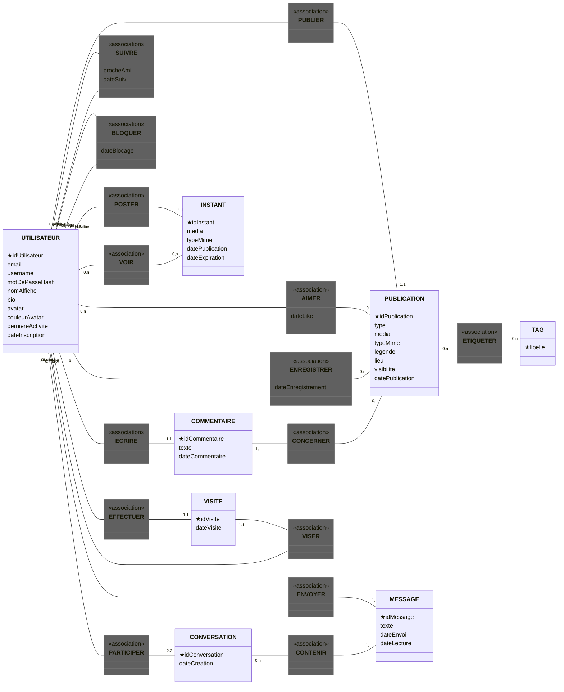
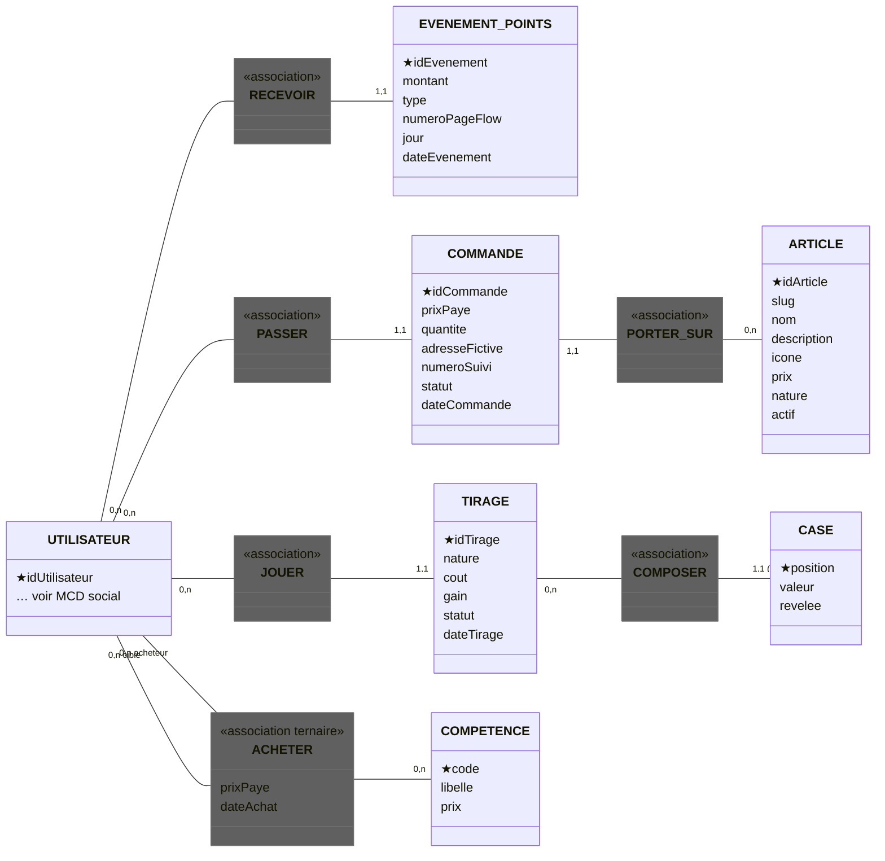
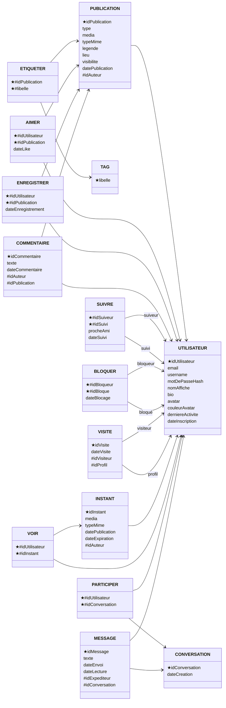
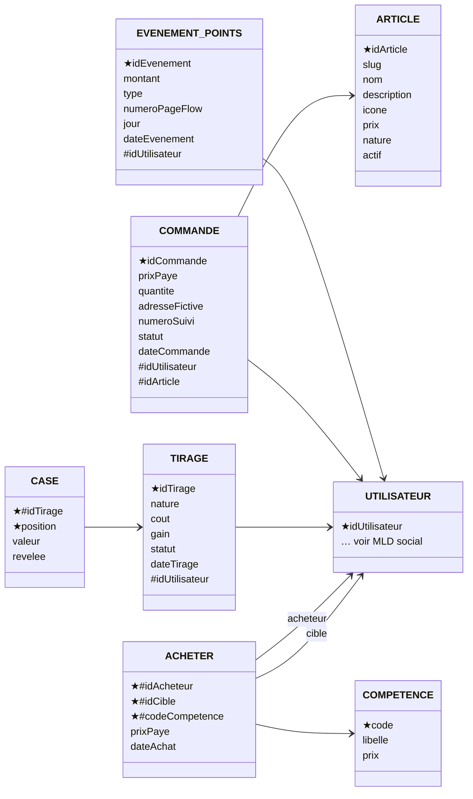
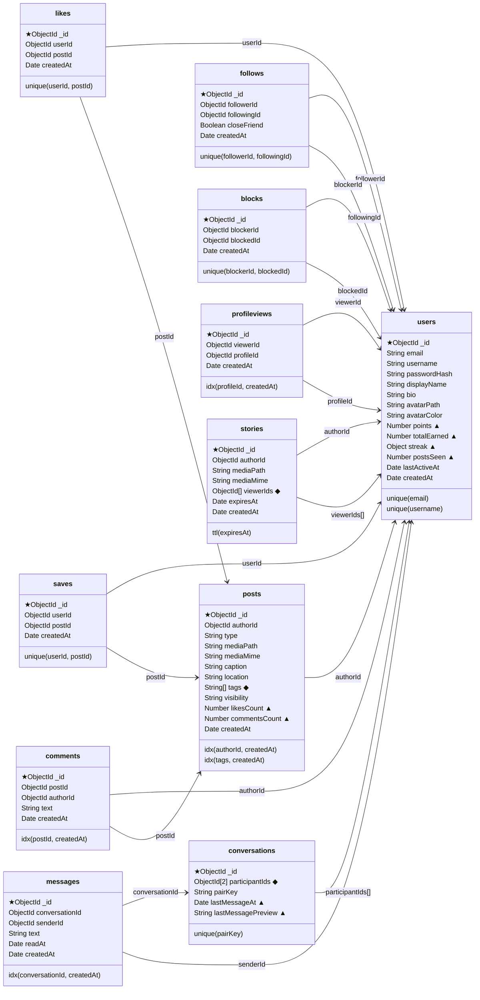
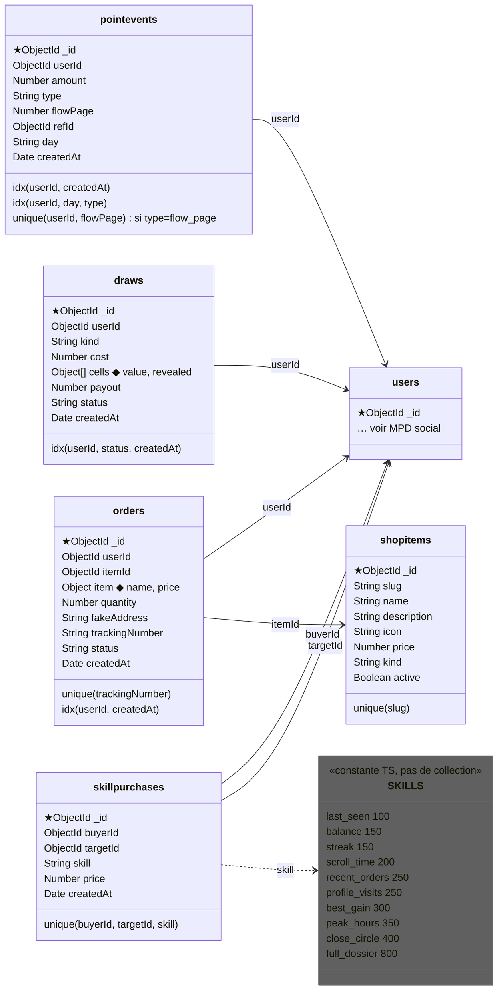

# Modèle de données (MERISE)

Trois niveaux, chacun coupé en deux domaines : **social** (comptes, publications, messages) et **économie** (points, boutique, Clairvoyance). Les diagrammes sont tirés de `lib/db/models/*.ts` ; si un modèle change, mettre à jour le diagramme ici.

GitHub et la plupart des éditeurs affichent les blocs Mermaid.

## Légende

| Signe | Sens |
|---|---|
| ★ | Identifiant (MCD), clé primaire (MLD), `_id` (MPD) |
| # | Clé étrangère (MLD) |
| 0,n / 1,1 | Cardinalité min,max, écrite côté entité (MCD) |
| (R) | Identification relative : CASE n'existe que dans son TIRAGE |
| ◆ | Donnée embarquée dans le document (MPD) |
| ▲ | Valeur dérivée stockée pour lire vite (MPD) |
| `unique()` `idx()` `ttl()` | Index MongoDB (MPD) |
| `<<association>>` | Association (MCD) |

Les attributs dérivés (soldes, compteurs) ne figurent pas au MCD : ils se calculent à partir des événements. Ils réapparaissent au MPD, marqués ▲.

## MCD

### Social

### Économie

ACHETER est ternaire : un acheteur, une cible, une compétence.

## MLD

Règles de passage : une cardinalité 1,1 devient une clé étrangère côté entité ; une association n,n devient une table dont la clé primaire est la paire de clés étrangères.

### Social

### Économie

## MPD (MongoDB)

Du MLD au MPD, six relations passent dans des documents :

| MLD | MPD | Pourquoi |
|---|---|---|
| TAG, ETIQUETER | `posts.tags[]` ◆ | Un tableau de chaînes indexé suffit pour la recherche |
| VOIR | `stories.viewerIds[]` ◆ | Lu à chaque affichage ; l'Instant disparaît en 24 h (TTL) |
| PARTICIPER | `conversations.participantIds[2]` ◆ + `pairKey` | Toujours 2 participants ; `pairKey` unique empêche les doublons |
| CASE | `draws.cells[]` ◆ | Les cases n'existent qu'à travers leur ticket |
| COMPETENCE | constante `SKILLS` | 10 lignes fixes, une collection n'apporte rien |
| COMMANDE → ARTICLE | `orders.item` ◆ `{name, price}` | Garde le nom et le prix au moment de l'achat |

Valeurs dérivées stockées (▲) :

| Source | Champ | Pourquoi |
|---|---|---|
| Σ EVENEMENT_POINTS | `users.points`, `totalEarned`, `streak`, `postsSeen` | Débit conditionnel sans recalculer l'historique |
| nombre de AIMER, COMMENTAIRE | `posts.likesCount`, `commentsCount` | Pas de comptage par post dans le fil |
| dernier MESSAGE | `conversations.lastMessageAt`, `lastMessagePreview` | Trie la liste des conversations sans jointure |

### Social

### Économie

